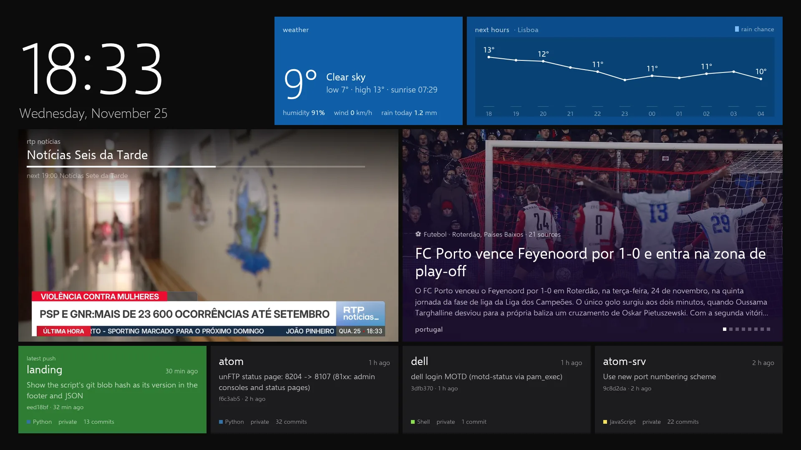

# Devlog

Screenshots of the dashboard on asus-arch's monitor as it changes, newest first.
Taken with `tools/snapshot.py`.

## 2026-11-25 · `2310dad` Metro-style dashboard: clock, weather, Kagi news, GitHub, RTP Notícias

- The first version: clock, weather now and the next hours (IPMA, Lisboa), RTP Notícias, Kagi News,
  four GitHub tiles. Rendered in a test browser on the dev VM (Chromium), not on the kiosk itself.

