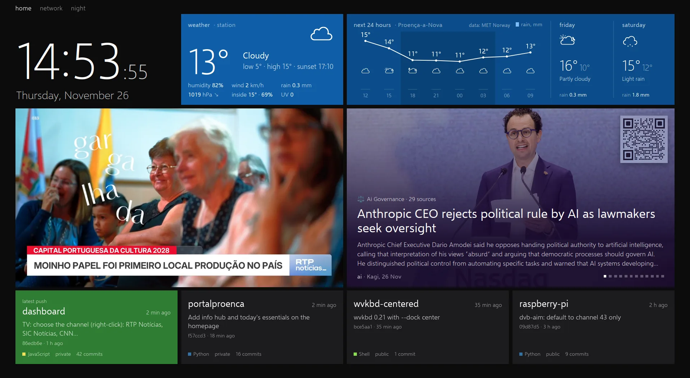
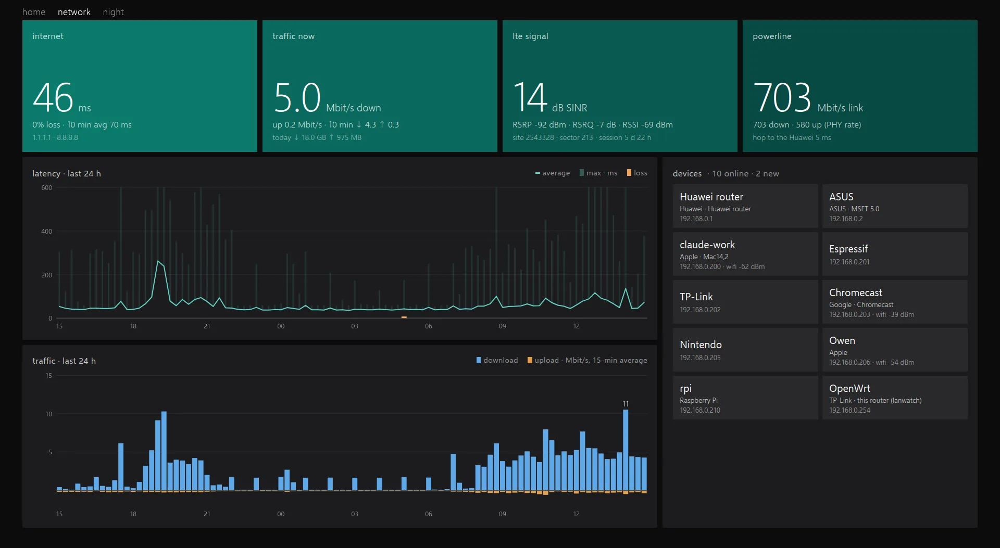
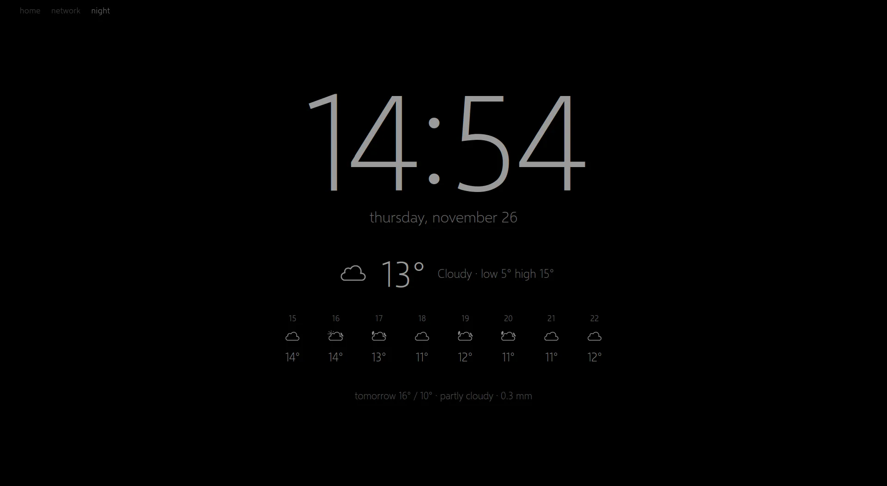

# Devlog

Screenshots of the dashboard on asus-arch's monitor as it changes, newest first.
Taken with `tools/snapshot.py`.

## 2026-11-26 · `8a91b22 Remote control channel (/api/events + /api/control) and devlog snapshots (tools/snapshot.py)`

- Since the first version: scenes (home, network, night) switched by the titles at the top or the
  mouse wheel; right-click settings on the back of tiles (news categories, keyword filters and QR
  code; forecast source and hourly/3-hourly; weather station on/off; clock seconds; TV channel;
  night schedule); MET Norway forecast with rain in mm and Meteocons icons; station pressure,
  indoor and UV; Kagi edition date; network scene from lanwatch and huawei-trafficd.

## 2026-11-25 · `2310dad` Metro-style dashboard: clock, weather, Kagi news, GitHub, RTP Notícias

- The first version: clock, weather now and the next hours (IPMA, Lisboa), RTP Notícias, Kagi News,
  four GitHub tiles. Rendered in a test browser on the dev VM (Chromium), not on the kiosk itself.

